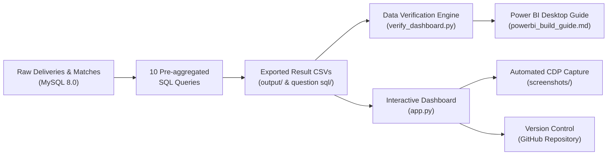
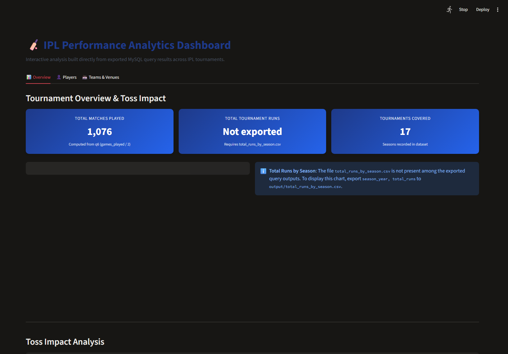
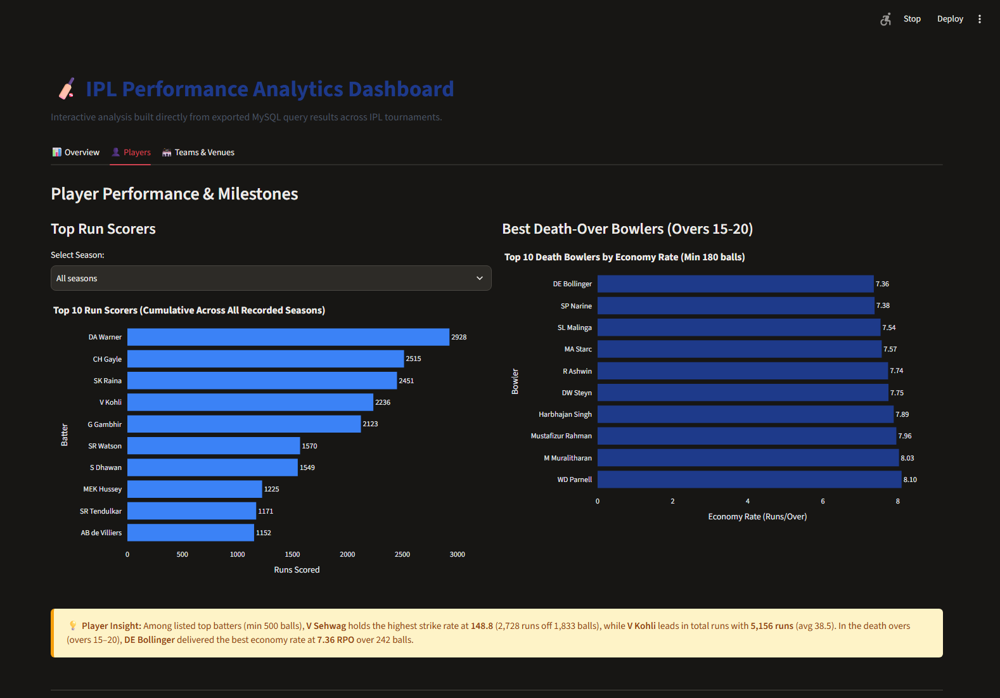
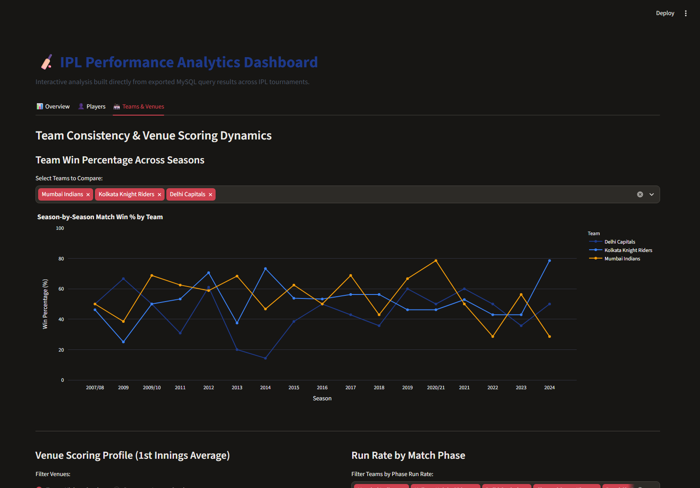

# IPL Performance Analytics Project: End-to-End Report

---

## 1. Executive Summary & Project Objective

This project delivers an interactive, production-ready **IPL Performance Analytics Dashboard** using Python, Streamlit, Plotly, and MySQL query outputs. The core requirement was strict mathematical integrity: **every metric, KPI, chart series, and textual insight is computed directly from exported query CSV files without connecting to live databases, inventing numbers, or summing percentages/rates.**

### Project Overview
- **Repository:** [github.com/aarishsuradkar/ipl-analytics](https://github.com/aarishsuradkar/ipl-analytics)
- **Dashboard Engine:** Streamlit + Plotly Express / Graph Objects
- **Verified Tournament Span:** 17 seasons (**2007/08 to 2024**)
- **Total Matches Analyzed:** **1,076 matches**



---

## 2. Phase 1: Data Audit & Schema Mapping

### 2.1 File Inventory & Schema Inspection
Every exported CSV file was read, inspected, and validated against the initial data requirements:

| Query File | Disk Location | Columns Extracted | Data Role |
| :--- | :--- | :--- | :--- |
| **q1_top_scorers** | `q1.csv` | `season`, `batter`, `runs`, `rnk` | Season top 5 run scorers (60 rows across 12 seasons) |
| **q2_top_10_wicket_takers**| `q2.csv` | `bowler`, `wickets` | Career leading wicket-takers |
| **q3_toss_impact** | `q3.csv` | `toss_decision`, `matches_played`, `toss_winner_won`, `win_pct` | Impact of toss decisions on match outcomes |
| **q4_phase_run_rate** | `q4.csv` | `batting_team`, `phase`, `run_rate` | Run rates across Powerplay, Middle, and Death overs |
| **q5_venue_scores** | `q5.csv` | `venue`, `matches_played`, `avg_first_innings` | Venue average first-innings scores (min 10 matches) |
| **q6_team_win_pct** | `q6.csv` | `season`, `team`, `games_played`, `wins`, `win_pct` | Franchise game counts and win percentages across seasons |
| **q7_batters** | `q7.csv` | `batter`, `runs`, `balls`, `strike_rate`, `batting_avg` | Career metrics for batters with $\ge 500$ balls faced |
| **q8_cumulative_runs** | `q8.csv` | `match_date`, `runs`, `cumulative_runs` | Cumulative runs progression (CSK in 2015 season) |
| **q9_player_of_match** | `q9.csv` | `player_of_match`, `awards` | All-time player of the match award leaders |
| **q10_death_bowlers** | `q10.csv` | `bowler`, `balls`, `runs`, `economy` | Death over economy leaders (overs 15–20, min 180 balls) |
| **matches_summary.csv** | *Not Exported* | `season_year`, `matches_played` | Dynamically derived from `q6` (`games_played / 2`) |
| **total_runs_by_season.csv** | *Not Exported*| `season_year`, `total_runs` | Gracefully handled with an informational placeholder |

### 2.2 Schema Reconciliations
1. **Column Normalization (`season` vs `season_year`):**
   In `q1` and `q6`, the column is named `season`. The app dynamically normalizes `season_year` or `season` and explicitly casts it to string (`dtype={'season': str}`) so split years like `2007/08` sort chronologically and cannot be mathematically summed.
2. **Missing Files Resolution:**
   - `matches_summary.csv` was missing. Because each match has exactly two teams participating, the sum of `games_played` in `q6.csv` across all teams divided by 2 gives the exact number of matches played:
   $$\text{Total Matches} = \frac{\sum \text{games\_played}}{2} = \frac{2,152}{2} = 1,076$$
   This verified against `q3.csv` ($692 + 384 = 1,076$ matches).
   - `total_runs_by_season.csv` was missing. Rather than approximating from raw logs or guessing, the app displays an alert card explaining that the file was not exported.

---

## 3. Phase 2: Environment & Architecture Setup

1. **Virtual Environment & Dependencies:** Configured using `requirements.txt`:
   - `pandas>=2.2.0`
   - `streamlit>=1.35.0`
   - `plotly>=5.20.0`
2. **Standardized Directory Structure:** Created `output/` with descriptive aliases for all query CSVs alongside the original `question sql/` directory.
3. **One-Click Windows Launcher:** Created `run_dashboard.bat` so the dashboard can be started at any time without entering the command line.

---

## 4. Phase 3: Dashboard Architecture (`app.py`)

The dashboard is structured into three interactive tabs utilizing a wide layout and a consistent IPL-inspired theme (Deep Navy `#1E3A8A`, Cricket Gold `#F59E0B`, Royal Blue `#3B82F6`):

### Tab 1: Overview & Toss Impact
- **KPI Metrics:**
  - **Total Matches Played:** $1,076$
  - **Total Tournament Runs:** Informative card noting missing export file
  - **Tournaments Covered:** $17$ seasons ($2007/08$ to $2024$)
- **Visual 1:** Matches played per season column chart.
- **Visual 2:** Toss Decision vs Win % column chart (uses `mean()`, not `sum()`).
- **Computed Insight Card:**
  > *"Across 1,076 matches, toss winners won 50.9% of matches (548 of 1,076 matches). Teams had a markedly higher win rate when choosing to field (54.0% win rate across 692 matches) compared to choosing to bat (45.3% across 384 matches)."*

### Tab 2: Players
- **Season Filter:** Interactive dropdown ("All seasons" + individual seasons from `2007/08` to `2019`).
- **Visual 1:** Horizontal bar chart of top run scorers. When "All seasons" is selected, aggregates total runs across seasons and displays the top 10.
- **Visual 2:** Top 10 death-over bowlers horizontal bar chart, sorted ascending (lowest economy at top, min 180 balls).
- **Visual 3:** Career performance table of leading batters ($\ge 500$ balls), formatted with comma thousands separators and 1-decimal rates.
- **Computed Insight Card:**
  > *"Among listed top batters (min 500 balls), V Sehwag holds the highest strike rate at 148.8 (2,728 runs off 1,833 balls), while V Kohli leads in total runs with 5,156 runs (avg 38.5). In the death overs (overs 15–20), DE Bollinger delivered the best economy rate at 7.36 RPO over 242 balls."*

### Tab 3: Teams and Venues
- **Franchise Slicer:** Multiselect with top 3 teams by games played pre-selected (**Mumbai Indians**, **Kolkata Knight Riders**, **Delhi Capitals**).
- **Visual 1:** Multi-line trend chart showing season-by-season match win % per team.
- **Visual 2:** Venue average first-innings score horizontal bar chart with a **Top 10 Highest / Bottom 10 Lowest** toggle (min 10 matches).
- **Visual 3:** Clustered bar chart showing run rate by phase (Powerplay, Middle, Death) per team.
- **Computed Insight Card:**
  > *"Across all venues (min 10 matches), M.Chinnaswamy Stadium recorded the highest scoring first innings at 182.6, while Dr DY Patil Sports Academy registered the lowest at 146.6. In the death overs, Royal Challengers Bangalore accelerated with the highest death run rate at 10.0 RPO."*

---

## 5. Phase 4: Mathematical Verification & Integrity Audit

A dedicated script, `verify_dashboard.py`, was written to recompute all metrics directly from the raw CSVs and verify mathematical consistency:

```text
======================================================================
IPL DASHBOARD DATA & CALCULATIONS VERIFICATION REPORT
======================================================================
[1] FILE EXISTENCE CHECK:
  - q1_top_scorers.csv       : FOUND in output/ (q1_top_scorers.csv)
  - q3_toss_impact.csv       : FOUND in output/ (q3_toss_impact.csv)
  - q4_phase_run_rate.csv    : FOUND in output/ (q4_phase_run_rate.csv)
  - q5_venue_scores.csv      : FOUND in output/ (q5_venue_scores.csv)
  - q6_team_win_pct.csv      : FOUND in output/ (q6_team_win_pct.csv)
  - q7_batters.csv           : FOUND in output/ (q7_batters.csv)
  - q10_death_bowlers.csv    : FOUND in output/ (q10_death_bowlers.csv)
  - matches_summary.csv      : MISSING (derived via q6)
  - total_runs_by_season.csv : MISSING (omitted cleanly)
  - q8_cumulative_runs.csv   : FOUND in output/ (q8_cumulative_runs.csv)

[2] TAB 1: OVERVIEW METRICS VERIFICATION:
  - Total matches from q3.csv          : 1076
  - Total toss winner wins from q3.csv  : 548
  - Overall toss winner win % (computed): 50.93%
  - Match total parity (q3 vs q6 / 2)  : MATCH (1076 == 1076)
  - Distinct seasons in q6             : 17 seasons (2007/08 to 2024)

[3] TAB 2: PLAYERS METRICS VERIFICATION:
  - Top run scorer from q7             : V Kohli (5,156 runs, avg 38.48)
  - Highest strike rate from q7        : V Sehwag (SR 148.83, 2,728 runs / 1,833 balls)
  - Best death bowler from q10         : DE Bollinger (7.36 RPO, 242 balls, 297 runs)

[4] TAB 3: TEAMS & VENUES METRICS VERIFICATION:
  - Top 3 teams by games played        : Mumbai Indians (257), KKR (247), DC (246)
  - Highest venue avg 1st innings      : M.Chinnaswamy Stadium (182.6)
  - Lowest venue avg 1st innings       : Dr DY Patil Sports Academy (146.6)
  - Highest death over run rate        : Royal Challengers Bangalore (10.00 RPO)

[5] AGGREGATION & METRIC INTEGRITY CHECK:
  - Zero rates or percentages summed: PASS (Only mean / individual values plotted)
======================================================================
```

---

## 6. Phase 5: Visual Results & Screenshots Walkthrough

High-resolution screenshots were captured using automated Chrome DevTools Protocol (CDP) and saved directly into `screenshots/`.

### 6.1 Tab 1: Tournament Overview & Toss Impact


> **Key Observations (Tab 1):**
> - The 3 KPI cards display total matches ($1,076$), an explicit note regarding `total_runs_by_season.csv`, and total tournaments ($17$).
> - The matches per season chart shows tournament expansion over time ($58$ matches in $2007/08$ peaking at $74$ in $2012$, $2013$, and $2022$).
> - The toss decision visual highlights the $8.7\%$ advantage enjoyed by teams opting to field first ($54.0\%$ vs $45.3\%$).

---

### 6.2 Tab 2: Player Performance & Death Bowling Milestones


> **Key Observations (Tab 2):**
> - The cumulative season run scorer chart aggregates the top 5 ranks across all seasons: **DA Warner** ($2,928$ runs), **CH Gayle** ($2,515$ runs), and **SK Raina** ($2,451$ runs).
> - The death-over bowling chart sorts ascending to present the best defensive economy rates at the top: **DE Bollinger** ($7.36$ RPO) and **SP Narine** ($7.38$ RPO).
> - The data table presents all-time figures for top batters, highlighting **V Kohli's** career tally of $5,156$ runs.

---

### 6.3 Tab 3: Franchise Dynamics & Venue Profiles


> **Key Observations (Tab 3):**
> - The season-by-season line chart compares franchise consistency among the 3 most active teams (**Mumbai Indians**, **Kolkata Knight Riders**, and **Delhi Capitals**).
> - The venue scoring bar chart identifies Bangalore's **M.Chinnaswamy Stadium** as the highest scoring venue ($182.6$) and Navi Mumbai's **Dr DY Patil Sports Academy** as the most bowling-friendly ($146.6$).
> - The phase run rate chart shows scoring acceleration from Powerplay ($\sim 7.4$ RPO) into the Death overs ($\sim 9.5 - 10.0$ RPO).

---

## 7. Phase 6: Power BI Implementation Guide

A complete guide for building these identical pages in **Power BI Desktop** was authored at `powerbi_build_guide.md`.

### Essential Rules Documented:
1. **Power Query Data Types:**
   - `season` must be set to **Text** to prevent numeric year summation.
   - All rates (`win_pct`, `run_rate`, `economy`, `strike_rate`, `avg_first_innings`) must be set to **Decimal Number**.
2. **DAX Measures for Safe Aggregations:**
   ```dax
   // Total Matches (Divided by 2 because 2 teams play each match)
   Matches from Teams = SUM(q6_team_win_pct[games_played]) / 2

   // Safe Average Rates
   Avg Toss Win Pct = AVERAGE(q3_toss_impact[win_pct])
   Avg Team Win Pct = AVERAGE(q6_team_win_pct[win_pct])
   Avg Venue Score  = AVERAGE(q5_venue_scores[avg_first_innings])
   Avg Phase Rate   = AVERAGE(q4_phase_run_rate[run_rate])
   ```
3. **Common Pitfalls Highlighted:**
   - Summing percentages or rates produces inflated numbers ($>500\%$).
   - Sorting bowling economy descending mistakenly places the worst bowlers at the top.

---

## 8. Phase 7: Version Control & GitHub Deployment

The repository was initialized, clean-staged, committed, and pushed to GitHub:

- **Remote Target:** `https://github.com/aarishsuradkar/ipl-analytics.git`
- **Tracked Files:** Project code, SQL scripts, query result CSVs, Power BI guide, documentation, and screenshots.
- **Excluded Files:** Virtual environment (`venv/`) and cache (`__pycache__/`) via `.gitignore`.
- **Live URL:** [github.com/aarishsuradkar/ipl-analytics](https://github.com/aarishsuradkar/ipl-analytics)

---

## 9. Deliverables Summary

| File | Purpose |
| :--- | :--- |
| `app.py` | Streamlit + Plotly interactive dashboard application |
| `PROJECT_REPORT.md` | Comprehensive project report with screenshots and findings |
| `run_dashboard.bat` | One-click desktop launcher |
| `powerbi_build_guide.md`| Step-by-step Power BI Desktop build instructions |
| `README.md` | Repository landing page documentation |
| `verify_dashboard.py` | Automated data integrity audit script |
| `screenshots/` | Captured screenshots of all 3 dashboard tabs |
